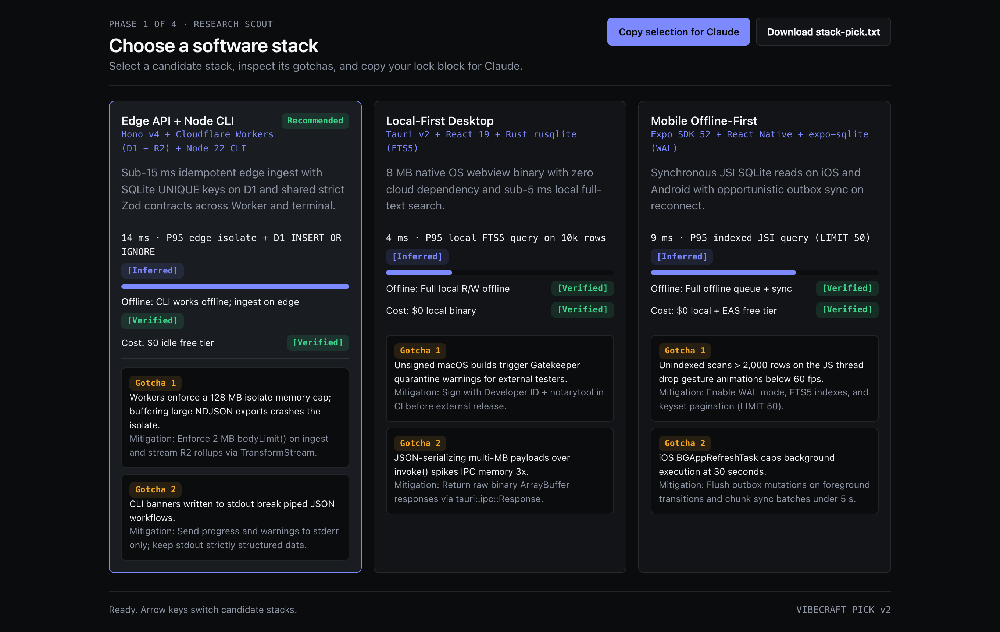
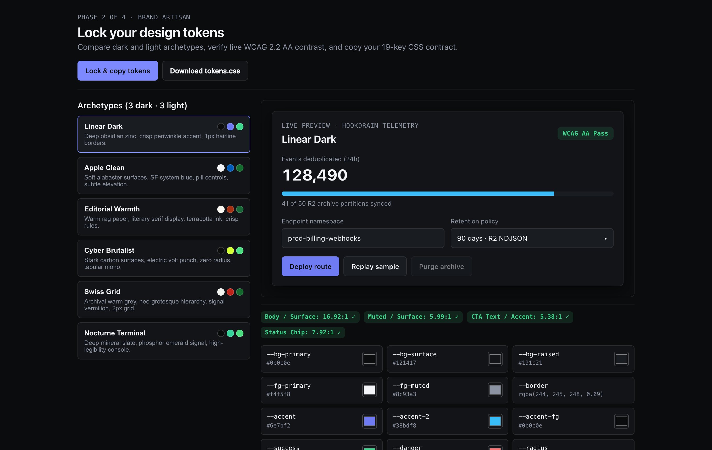
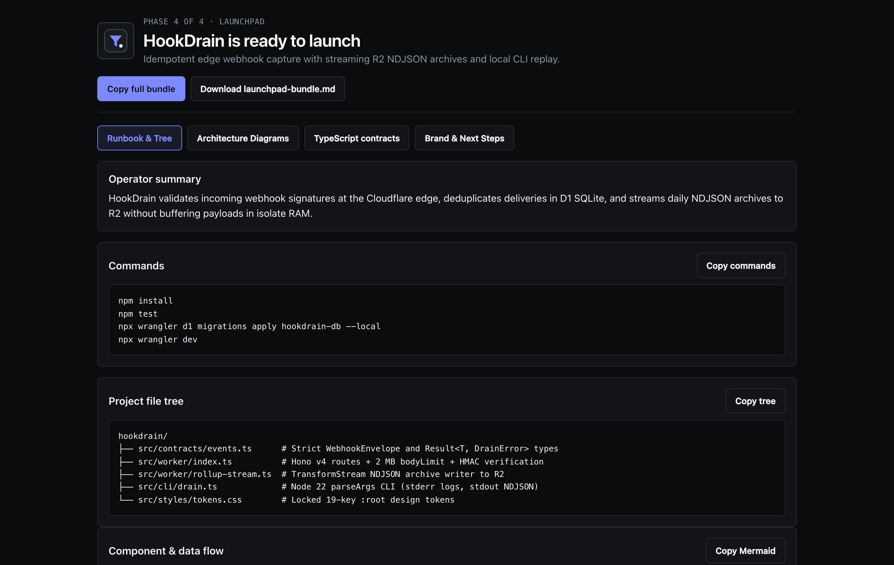
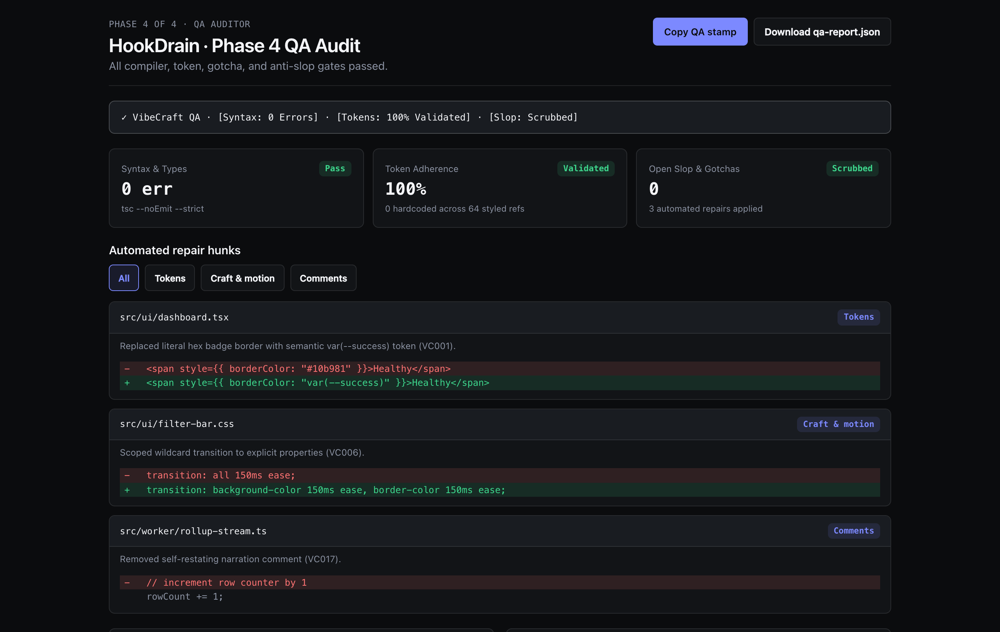

# VibeCraft

**A user-gated, four-phase software studio plugin and Generative UI artifact suite for Claude Code and Claude Desktop.**

[](LICENSE)
[](package.json)
[](package.json)

VibeCraft turns vague "build me X" prompts into a disciplined four-phase studio workflow (**Scout -> Artisan -> Architect -> Builder + QA Auditor**). Instead of dumping thousands of lines of unreviewed code on turn one, Claude pauses at concise decision gates, renders self-contained interactive HTML artifacts for stack selection and WCAG 2.2 AA design-token locking, enforces strict domain contracts before writing implementation code, and audits every output against a 19-rule static analyzer (`vibecraft-audit`).

---

## Install in Under Two Minutes

### Option 1: Claude Code Native Plugin (Recommended)

On Claude Code `>= 2.1.275`, install directly from GitHub in one command:

```text
/plugin install vibecraft --marketplace crankyjediii/vibecraft
```

On earlier Claude Code `2.1.x` builds, add the marketplace first:

```text
/plugin marketplace add crankyjediii/vibecraft
/plugin install vibecraft@vibecraft
```

Verify active skills (`~734` idle context tokens vs `~20k+` for monolithic `CLAUDE.md` files):

```bash
claude plugin details vibecraft@vibecraft
```

### Option 2: Claude Desktop (Skill ZIP or Project Bundle)

1. Download `vibecraft-skill.zip` from the [latest GitHub Release](https://github.com/crankyjediii/vibecraft/releases/latest) (or use `dist/vibecraft-desktop/vibecraft-skill.zip` from a local clone).
2. Open **Claude Desktop -> Settings -> Capabilities -> Skills** and upload `vibecraft-skill.zip`.
3. *(Optional Project setup)* Create a Claude Project, paste `dist/vibecraft-desktop/PROJECT_INSTRUCTIONS.md` into **Project Instructions**, and attach the files in `dist/vibecraft-desktop/knowledge/`.

### Option 3: Local MCP & Standalone Skill Installer (`macOS`, `Linux`, `Windows`)

Merges version-pinned MCP servers (`vibecraft-filesystem`, `vibecraft-brave-search`, `vibecraft-fetch`) into `claude_desktop_config.json` with `0600` permissions and installs `~/.claude/skills/vibecraft`:

```bash
git clone https://github.com/crankyjediii/vibecraft.git
cd vibecraft
bash install.sh --dry-run   # Preview planned changes without writing files
bash install.sh             # Interactive install (pass --yes for non-interactive)
node scripts/doctor.mjs     # Verify Node, MCP config, skills, and optional tools
```

On **Windows PowerShell**:

```powershell
git clone https://github.com/crankyjediii/vibecraft.git
Set-Location vibecraft
pwsh -ExecutionPolicy Bypass -File .\install.ps1 -DryRun
pwsh -ExecutionPolicy Bypass -File .\install.ps1
node .\scripts\doctor.mjs
```

---

## What VibeCraft Renders at Each Gate

### Phase 1 · Research Scout (`stack_matrix_artifact.html`)

Benchmarks `3 to 4` candidate stacks across `6` domain archetypes (`web-saas`, `local-desktop`, `cli-tool`, `edge-api`, `mobile-offline`, `static-content`) with explicit `[Verified]` vs `[Inferred]` epistemic tags and concrete failure-mode gotchas.



### Phase 2 · Brand Artisan (`brand_studio_artifact.html`)

Auditions `6` WCAG 2.2 AA pre-verified palettes (`Linear Dark`, `Apple Clean`, `Editorial Warmth`, `Cyber Brutalist`, `Swiss Grid`, `Nocturne Terminal`) with live contrast math and exports a 19-key `:root` CSS contract (`VIBECRAFT LOCK v2`).



### Phase 3 & 4 · System Architect & Launchpad (`launchpad_artifact.html`)

Locks file boundaries, Mermaid data-flow and sequence diagrams, and strict domain contracts in Phase 3 before materializing the full runbook, sanitized geometric SVG mark, and copyable source tree in Phase 4.



### Phase 4 · QA Auditor & Deslop Report (`qa_diff_artifact.html`)

Runs compiler checks plus the 19-rule Audit Engine v2 (`VC000`..`VC018`), executes up to `3` behavior-preserving repair passes, and reports measured syntax, token-adherence, and slop counts.



---

## 60-Second Session Walkthrough

```text
You:    /vibecraft:build an edge webhook deduplicator with a local replay CLI

Claude: Two quick forks before scouting the stack (reply `go` for starred defaults):
        1. Target volume? `[1]* <= 50 req/s (SQLite/D1)` `[2] > 500 req/s (Redis + Postgres)`
        2. Replay auth?   `[1]* Shared HMAC secret`      `[2] OIDC bearer token`

You:    go

Claude: `[ ● Scout ] ──› [ ○ Artisan ] ──› [ ○ Architect ] ──› [ ○ Builder ]`
        Defaults locked. Compare 3 stacks in `vibecraft/01-stack-matrix.html`.
        `[1]* Lock Hono v4 + Cloudflare D1/R2 + Node 22 CLI` `[2] Fastify + LiteFS` `[3] Bun + Turso`

You:    1

Claude: `[ ✓ Scout ] ──› [ ● Artisan ] ──› [ ○ Architect ] ──› [ ○ Builder ]`
        Stack locked with 128 MB isolate-cap and stderr-logging gotchas. Inspect `vibecraft/02-brand-studio.html`:
        `[1]* Nocturne Terminal (dark)` `[2] Linear Dark` `[3] Swiss Grid (light)` `[4] Apple Clean`

You:    1

Claude: `[ ✓ Scout ] ──› [ ✓ Artisan ] ──› [ ● Architect ] ──› [ ○ Builder ]`
        Locked all 19 Nocturne Terminal tokens. Review the 6-file blueprint in `vibecraft/03-architecture.html`.
        `[1]* Approve & build` `[2] Revise file tree` `[3] Revise data contracts`

You:    1

Claude: `[ ✓ Scout ] ──› [ ✓ Artisan ] ──› [ ✓ Architect ] ──› [ ● Builder ]`
        Built all 6 modules and verified R2 TransformStream rollups. See `vibecraft/04-qa-diff.html` and `04-launchpad.html`.
        `✓ VibeCraft QA · [Syntax: 0 Errors] · [Tokens: 100% Validated] · [Slop: Scrubbed]`
```

---

## Slash Commands & CLI Tools

| Slash Command (Claude Code) | Standalone Equivalent | Purpose |
| :--- | :--- | :--- |
| `/vibecraft:build <idea>` | Natural language prompt | Run the gated 4-phase studio workflow from Intake to Launchpad |
| `/vibecraft:stack <constraints>` | `skills/research-scout/SKILL.md` | Run Phase 1 Research Scout standalone and emit `01-stack-matrix.html` |
| `/vibecraft:brand <domain>` | `skills/brand-artisan/SKILL.md` | Run Phase 2 Brand Artisan standalone and emit `02-brand-studio.html` |
| `/vibecraft:audit [paths...]` | `npx vibecraft-audit [paths...]` | Audit files against `VC000`..`VC018`, repair safe slop, and emit `04-qa-diff.html` |
| `/vibecraft:launchpad` | `skills/fullstack-builder/SKILL.md` | Package an existing codebase into `04-launchpad.html` |
| `/vibecraft:doctor` | `node scripts/doctor.mjs` | Verify Node, plugin manifests, MCP config syntax/permissions, and optional CLIs |

### Standalone Static Analyzer (`vibecraft-audit`)

Run the zero-dependency 19-rule static analyzer in any repository or CI pipeline:

```bash
node scripts/audit/cli.js src/                         # Human-readable table (exit 0 clean, 1 findings, 2 usage)
node scripts/audit/cli.js src/ --fix                   # Auto-repair safe mechanical rules (VC006, VC014, VC017)
node scripts/audit/cli.js src/ --json                  # Structured JSON report
node scripts/audit/cli.js src/ --sarif > audit.sarif   # SARIF 2.1.0 for GitHub Code Scanning
```

See [docs/rules.md](docs/rules.md) for the complete `VC000`..`VC018` rule catalog and `vibecraft-ignore` directive syntax.

---

## Compatibility & Verification Matrix

Every claim below reflects actual verification status:

| Surface / Platform | Status | Verification Evidence |
| :--- | :--- | :--- |
| Claude Code CLI (`>= 2.1.x`) on macOS & Linux | **Tested** | `claude plugin validate --strict`, `marketplace add`, `plugin install`, `plugin details` (`docs/audits/20-packaging-verification.md`) |
| Generative UI HTML Artifacts (Chrome / Chromium, light + dark, `375px`..`1440px`, offline) | **Tested** | `scripts/verify-templates-browser.mjs` (`17/17` suites, `0` `axe-core@4.10.2` violations) |
| `install.sh` on macOS (`/bin/bash 3.2`) & Ubuntu Linux (`bash 5.x`) | **Tested** | `tests/installer_e2e.test.js` + `shellcheck install.sh` (`0` warnings) |
| `install.ps1` on Windows (`windows-latest` PowerShell 7) | **Tested in CI / Untested on local macOS host** | Verified via `PSScriptAnalyzer` + `installer_e2e.test.js` on `windows-latest` in `.github/workflows/ci.yml` |
| `vibecraft-skill.zip` archive structure & PKZIP CRC integrity | **Tested** | `unzip -t dist/vibecraft-desktop/vibecraft-skill.zip` + pure-Node header verification |
| Claude Desktop Electron GUI interactive upload click-through | **Untested in headless automation** | Requires manual GUI session inside Claude Desktop (`Settings -> Capabilities -> Skills`) |

---

## Security & Privacy Model

- **Zero runtime npm dependencies:** `package.json` declares zero runtime dependencies. Every script uses built-in Node.js (`node:fs`, `node:crypto`, `node:zlib`, `node:path`) modules.
- **Exact MCP supply-chain pinning:** `.mcp.json` and `claude_desktop_config.json` pin `@modelcontextprotocol/server-filesystem@2.2.0`, `@brave/brave-search-mcp-server@2.1.4`, and `mcp-server-fetch==2026.11.4`.
- **Environment-only secrets:** `BRAVE_API_KEY` is referenced via `${BRAVE_API_KEY}` and never written in plaintext by `install.sh` or `install.ps1`.
- **Offline HTML artifacts:** `templates/generative-ui/*.html` execute zero Tailwind CDN or Google Fonts requests, verify optional Mermaid `11.4.1` via `sha384` SRI with an offline `<pre>` source fallback, and sanitize `LAUNCH.logo` through an allowlisted geometric SVG cloner.

---

## Troubleshooting

| Symptom | Cause | Fix |
| :--- | :--- | :--- |
| `claude_desktop_config.json` fails to load after manual edit | Trailing comma or syntax error in JSON | Run `node scripts/doctor.mjs` to pinpoint the line, then repair JSON before re-running `install.sh` |
| `vibecraft-fetch` MCP server shows disconnected | Optional `uvx` CLI (`uv`) is not installed | Install `uv` (`https://docs.astral.sh/uv/`) or remove `vibecraft-fetch` if web-page fetching is unneeded |
| `vibecraft-brave-search` returns auth error | `BRAVE_API_KEY` is unset in environment | Export `BRAVE_API_KEY` in your shell profile (or skip; Claude falls back to built-in web search or `[Inferred]` tags) |
| Clipboard copy button is blocked inside sandboxed iframe | Host webview restricts `navigator.clipboard` | VibeCraft automatically reveals the `#fallback` `<textarea>` and provides a direct `Download` button on every artifact |
| Mermaid diagram shows raw source block | Device is offline or CDN is blocked by firewall | Expected offline fallback (`COR-02`); copy the Mermaid source or view online with SRI verification |

---

## Uninstall

**Claude Code Plugin:**

```text
/plugin uninstall vibecraft@vibecraft
/plugin marketplace remove vibecraft
```

**Local MCP & Standalone Skill (`macOS` / `Linux`):**

```bash
bash install.sh --uninstall
```

**Local MCP & Standalone Skill (`Windows PowerShell`):**

```powershell
pwsh -ExecutionPolicy Bypass -File .\install.ps1 -Uninstall
```

---

## Documentation

- [Documentation Index](docs/index.md)
- [System Architecture](docs/architecture.md)
- [Operator Interaction Guide](docs/interaction_guide.md)
- [Audit Engine v2 Rules (`VC000`..`VC018`)](docs/rules.md)
- [Skill Authoring Guide](docs/skill-authoring.md)
- [Release Process](docs/release-process.md)
- [Contributing](CONTRIBUTING.md) · [Security Policy](SECURITY.md) · [Changelog](CHANGELOG.md) · [MIT License](LICENSE)
