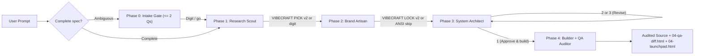

# System Architecture

VibeCraft is a **user-gated, four-phase software studio** packaged simultaneously as a native Claude Code plugin (`.claude-plugin/`), a Claude Desktop Skill ZIP and Project bundle (`dist/vibecraft-desktop/`), and a zero-dependency Node.js static analyzer (`scripts/audit/`).

## 1. Design Principles

1. **Explicit human gates over runaway generation ([ADR 0001](decisions/0001-gated-pipeline.md)):** Every phase boundary (`Scout -> Artisan -> Architect -> Builder`) pauses for a 1-keystroke confirmation or structured lock block (`VIBECRAFT PICK v2` / `VIBECRAFT LOCK v2`). Only Builder -> QA Auditor executes within the same turn so generated code is never delivered unaudited.
2. **Progressive context disclosure:** Always-on skill frontmatter descriptions consume `~734` tokens (`claude plugin details`), loading detailed rubrics (`references/craft-12.md`, `code-quality.md`, `gotcha-library.md`, `examples.md`) and specialist role skills only when invoked.
3. **Self-contained offline HTML artifacts ([ADR 0004](decisions/0004-inlined-css-over-tailwind-cdn.md)):** All four Generative UI templates (`templates/generative-ui/*.html`) compile from `scripts/build-templates.mjs` with inlined logical CSS, system font stacks, allowlisted geometric SVG sanitization, and offline `<pre>` diagram fallbacks.
4. **Measured verification over LLM self-praise:** `scripts/audit/cli.js` (`vibecraft-audit`) checks 19 deterministic rules (`VC000`..`VC018`), and `qa_diff_artifact.html` reports `[Syntax: Not Run]` whenever shell compilation is unavailable.

## 2. Pipeline State Machine



## 3. Repository Layout

```text
vibecraft/
├── .claude-plugin/               # Native Claude Code plugin & marketplace manifests + icon.png
├── .mcp.json                     # Version-pinned project MCP servers (${BRAVE_API_KEY} env ref)
├── claude_desktop_config.json    # Version-pinned Claude Desktop MCP template
├── commands/                     # /vibecraft:{build,stack,brand,audit,launchpad,doctor}
├── skills/
│   ├── vibecraft/                # Orchestrator SKILL.md + references/{craft-12,code-quality,gotcha-library,examples}.md
│   ├── research-scout/           # Phase 1 specialist skill (6 archetypes, epistemic tagging)
│   ├── brand-artisan/            # Phase 2 specialist skill (19-key :root contract, WCAG 2.2 AA)
│   ├── system-architect/         # Phase 3 specialist skill (file boundaries, Mermaid, strict contracts)
│   ├── fullstack-builder/        # Phase 4 specialist skill (token-clean implementation + Launchpad)
│   └── qa-auditor/               # Phase 4 specialist skill (compiler + 19-rule audit + deslop loop)
├── templates/generative-ui/      # Built offline HTML artifacts (stack_matrix, brand_studio, qa_diff, launchpad)
├── scripts/
│   ├── audit/                    # Zero-dependency Audit Engine v2 (cli, engine, rules, contrast, fixer, sarif)
│   ├── lib/                      # Shared installer-core.mjs + versioned lock-blocks.js parser
│   ├── build-templates.mjs       # Deterministic HTML template builder & drift checker
│   ├── build-dist.mjs            # Deterministic Desktop bundle, PKZIP writer & system_prompt.md sync
│   ├── doctor.mjs                # Environment & configuration diagnostic CLI
│   └── verify-templates-browser.mjs # Headless Chromium + axe-core WCAG 2.2 AA + XSS + fuzz suite
├── dist/vibecraft-desktop/       # Synchronized Desktop Skill ZIP, Project Knowledge & SHA256SUMS.txt
├── evals/                        # 17 structural invariants + 14 calibrated golden/adversarial scenarios
└── tests/                        # Unit, 38 rule fixtures, lock-block, installer E2E & link tests
```

## 4. Handoff Contracts & Token Math

- **`VIBECRAFT PICK v2` (`scripts/lib/lock-blocks.js`):** Captures `ArchetypeId`, `Stack`, `Why`, `Performance`, `Offline`, `Cost` with `[Verified]` / `[Inferred]` tags, and numbered `[Gotcha N]` + `Fix:` pairs that Phase 3 and Phase 4 must mitigate in code.
- **`VIBECRAFT LOCK v2` (`scripts/lib/lock-blocks.js`):** Captures `Archetype`, `ThemeId`, `Scheme`, optional contrast `Waivers`, and all 19 canonical `:root` custom properties (`--bg-primary` through `--shape-opacity`).
- **Token Adherence Score (`qa_diff_artifact.html`):** Excludes token-definition files (`tokens.css` or `note: "definitions"`) from the denominator so defining 19 variables never inflates component token compliance (`PRM-11`).

## 5. Audit Engine v2 (`VC000`..`VC018`)

`scripts/audit/engine.js` runs single-file (`auditFileSource`) and cross-module (`auditPaths` for `VC015 dead-export`) checks across `.css`, `.html`, `.js/.mjs/.cjs/.jsx`, `.ts/.tsx`, `.sh`, and `.json`. `scripts/audit/contrast.js` parses hex and `rgba()` custom properties, composites alpha surfaces over `--bg-primary`, and verifies WCAG 2.2 AA contrast (`>= 4.5:1`) for body text, muted copy, accent CTAs, and tinted status chips.
