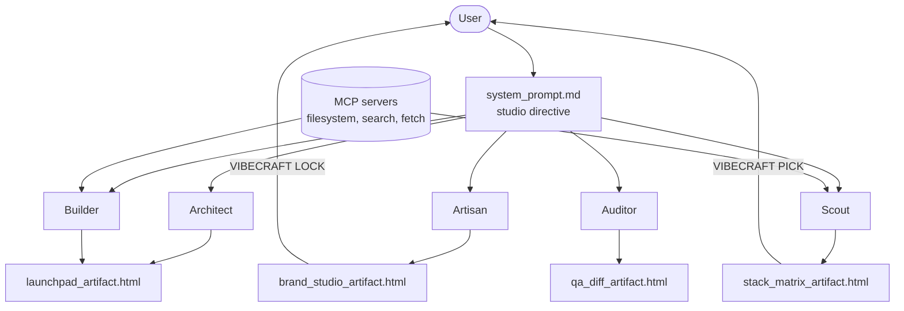
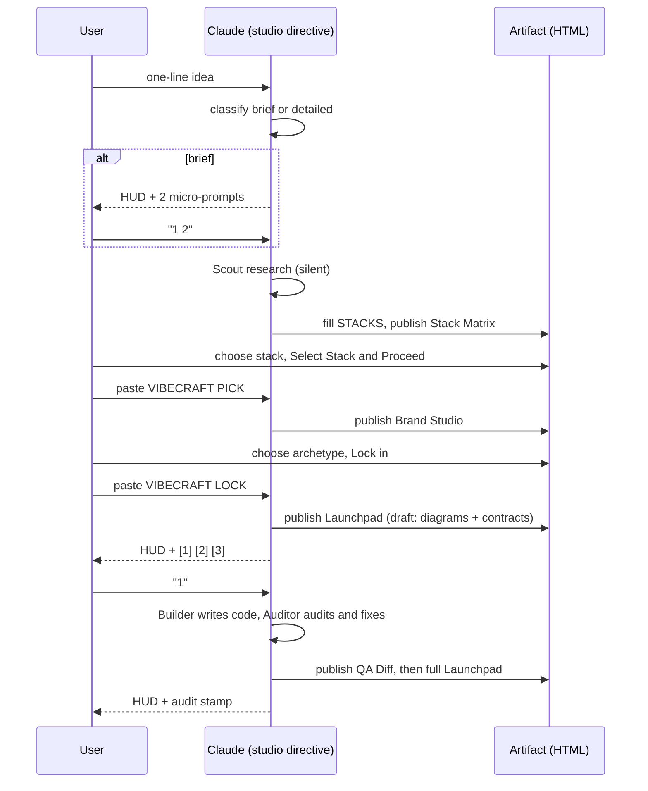

# VibeCraft architecture

VibeCraft is instructions plus templates, not a server. Claude is the runtime. Five role files describe the work, four HTML templates carry the interface, and a small amount of tooling wires them into Claude Desktop and Claude Code.

## Component map

## Session sequence

## State without a server

Claude Desktop has no shared state between artifacts and chat, so state travels as text the user pastes back. Each artifact produces one block; the directive treats a pasted block as authoritative.

| Block | Produced by | Carries |
|---|---|---|
| `VIBECRAFT PICK` | Stack Matrix | Chosen stack, why, performance, offline, cost, gotcha and fix |
| `VIBECRAFT LOCK` | Brand Studio | Archetype name and the complete `:root` token block |

The user can also change a decision in plain chat. Chat wins over the artifact.

## Templates

Each template is one self-contained HTML file: Tailwind (CDN) for layout utilities, hand-written CSS driven by custom properties for components, and vanilla JavaScript. Each has exactly one data block that Claude replaces:

| Template | Data block | Interaction |
|---|---|---|
| `stack_matrix_artifact.html` | `CONCEPT`, `STACKS` | Radio cards, copy selection or gotcha only |
| `brand_studio_artifact.html` | `THEMES` (between `@tokens` markers) | Archetype radios rewrite `:root`; lock copies tokens |
| `qa_diff_artifact.html` | `REPORT` | Category filter on the diff; copy stamp or report |
| `launchpad_artifact.html` | `LAUNCH` | Tabs, Mermaid render, per-block and Copy All |

Common behavior: tokens only for color; hover, focus-visible, active and disabled states; `prefers-reduced-motion` honored; clipboard via `navigator.clipboard` with an `execCommand` fallback and, if both fail, the text is selected and shown for manual copying.

The Launchpad skips empty fields and empty tabs, so the Architect can publish a draft containing only diagrams and contracts.

## The audit rules

`tests/audit_rules_test.js` exports `audit(source, filename)`; the Auditor role describes the same rules.

| Rule | Detects | Applies to |
|---|---|---|
| `hardcoded-color` | `#[0-9a-fA-F]{3,8}\b`, `rgb(a)(`, `hsl(a)(`, `oklch(` outside token definitions | css, html, js, ts |
| `placeholder` | `TODO`/`FIXME`/`XXX`/`HACK` comments, stub phrases, lorem ipsum, stock names | all code |
| `type-laundering` | `as any`, `as unknown as`, `: any`, `<any>` | ts |
| `comment-slop` | Comments that narrate (`// increment ...`) | js, ts |
| `transition-all` | `transition: all` and Tailwind `transition-all` | css, html |
| `gradient` | `*-gradient(` and `bg-gradient-to-*` | css, html |
| `z-index-arms-race` | `z-index` of four digits or more | css, html |
| `missing-return-type` | Exported functions without a return type (single-line signatures) | ts |

Token definitions are exempt in two ways: a line that declares a custom property (`--name: value`), and everything between `@tokens:start` and `@tokens:end` markers.

## Decisions

- **Gating beats parallel artifacts.** The brief describes both artifacts appearing at once and a rule that research and questions come before artifacts. The directive follows the gated rule: questions first for brief ideas, then Stack Matrix, then Brand Studio. The first reply still arrives immediately.
- **Craft rules beat archetype wording.** "Laser glow" for Linear Dark is implemented as flat indigo and cyan accents with hairline borders. R1 and R2 forbid glow and gradients.
- **Hex lives only in tokens.** Archetype palettes necessarily contain hex values, so they sit in clearly marked token blocks that the audit exempts. Everything else must use `var(--token)`.
- **Skill path.** Claude Code discovers skills through a `SKILL.md`. The installer builds it from `system_prompt.md` and places the role files, templates and audit script beside it, so the relative paths in the directive keep working.
- **MCP packages were verified at build time.** The old npm Brave Search server is deprecated and `server-fetch` is not an npm package, so the config uses `@brave/brave-search-mcp-server` and `uvx mcp-server-fetch`.
